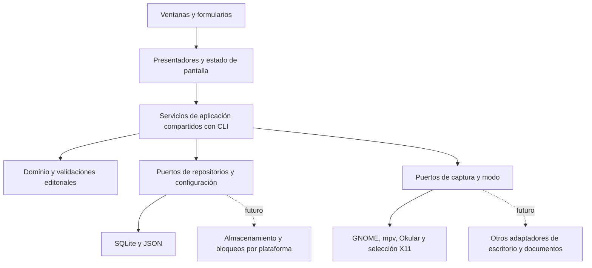

# Propuesta de interfaz de gestión y revisión

Estado: **propuesta para revisión, sin implementación ni elección definitiva de
biblioteca**. Base técnica: `32ec6e9`, bloque GNOME validado en 026–028.
El siguiente incremento sugerido es lectura de trabajos e incidencias en Linux;
Excel y la portabilidad de la captura tienen requisitos separados.

## Alcance y límites

La interfaz reunirá trabajos, selección activa, fuentes, revisión de incidencias,
tipos, fórmulas genéricas y asignaciones de atajos. Preparará los datos para una
exportación futura sin inventar una plantilla corporativa. No añadirá estados
editoriales, borrado de trabajos/incidencias o sincronización sin acuerdo previo.

No incluye un visor PDF propio ni sustituye mpv/Okular. Una biblioteca portable
permite construir ventanas para varios sistemas; no convierte GNOME, D-Bus,
PRIMARY, flock o los sockets actuales en integraciones portables.

## Capas propuestas y reutilización

El dominio existente (`Incident`, `TypeCatalog`, `DescriptionCatalog` y captura)
conserva sus reglas y no importa widgets, SQLite ni Excel. Los presentadores
reciben datos simples y devuelven acciones/errores estructurados; los widgets
solo muestran estado y recogen entradas. Los modelos de tabla de la biblioteca
son modelos de presentación, no entidades de dominio.

Los servicios de aplicación delimitan transacciones, trabajo explícito y
exclusión. Reutilizarán `JobStore`, `incident_review.edit_incident`, los catálogos,
repositorios y controladores existentes, sin duplicar reglas en callbacks.
No se parseará stdout humano de las CLI ni se llamarán métodos privados como
`JobStore._get` desde las vistas. Allí donde hoy la orquestación vive en una CLI,
un incremento específico extraerá una API compartida conservando su conducta.
No se hará una reorganización masiva del árbol actual.

Posible organización futura bajo `src/audiobook_qc/`: `application/` para los
servicios compartidos y `gui/` para arranque, presentadores y vistas. Son nombres
propuestos; no se crean paquetes ni se cambian imports en este cierre.

| Área | Base existente | Trabajo necesario antes de exponer escrituras en GUI |
| --- | --- | --- |
| Trabajos | `JobStore`, metadatos UUID y SQLite por trabajo | API pública de consulta/operación con destino explícito y errores de bloqueo |
| Revisión | `incident_review`, repositorio y CLI JSON | Compartir orquestación, borrador y detección de cambios durante la edición |
| Tipos/atajos lógicos | `type_config`, `TypeCatalog`, `types_cli` | Servicio de guardado validado; actualmente se editan mediante JSON |
| Fórmulas | `description_config`, `descriptions`, valores por defecto del tipo | Guardado validado y previsualización sin reescribir historial |
| Teclas GNOME | `ShortcutMode`, journal y migración explícita | Adaptador de ajustes con preflight y conflictos; sin repetir migración |
| Exportación | Completitud y composición editorial existentes | Solo preparación de datos; exportador bloqueado por plantilla |

## Pantallas y comportamiento

**Trabajos.** Listado con nombre y UUID, crear y seleccionar explícitamente.
La raíz global se configura en una acción diferenciada que explica que no mueve
carpetas y puede borrar la selección. El encabezado muestra siempre trabajo
activo y modo de captura. Abrir un trabajo para revisar no lo selecciona como
destino de atajos: son decisiones distintas y visibles. No se cambia la raíz
ni se migra una base como efecto lateral de abrir una pantalla.

**Fuentes y modo.** Mostrar asociación y disponibilidad por separado. Selección
válida no equivale a audio/PDF disponibles. Ofrecer preparación explícita con
los lanzadores existentes, estado de modo y controles on/off. Consultas con
timeout; nunca arrancar aplicaciones al refrescar una tabla. Tras cerrar mpv,
mostrar fuente indisponible sin fallback ni borrado manual de sockets. El
relanzamiento no promete recuperar capítulo/posición. La GUI no autoriza por sí
misma la captura con foco en su ventana: se mantiene la política actual.

**Incidencias.** Tabla y panel de edición con ID, tipo, audio/posición,
documento/página, texto, fórmula, comentario y vista previa. El destino de una
edición es el par UUID/ID mostrado, aunque cambie la selección global. Campos
editables según `EDITABLE_FIELDS`; IDs, nombre/ruta de audio, fechas y exported
se muestran como protegidos. Guardar usa la validación existente; cancelar no
escribe. Mantener valores temporales con precisión exacta, Unicode y saltos de
línea. Un cambio de tipo exige tratar explícitamente una fórmula incompatible.

**Tipos y fórmulas.** Distinguir ID estable, etiqueta, habilitación, orden,
fórmula predeterminada y repertorio de descripciones por ID. Conservar los siete
códigos iniciales; altas adicionales solo cuando estén solicitadas. Deshabilitar
no borra historial; los registros con tipos históricos siguen siendo legibles.
Aplicar una fórmula copia su texto al registro: actualizar el catálogo no cambia
incidencias anteriores. Vista previa y comentario continúan siendo independientes.
La escritura de configuración requiere validación completa y publicación atómica,
además de detección de cambios externos; ese servicio aún debe diseñarse/probarse.

**Atajos.** Separar Fn lógica → tipo (catálogo) de combinación física → comando
(escritorio). Mostrar conflictos y cambios propuestos antes de aplicarlos. El
primer incremento de esta pantalla será de consulta; su editor no escribirá
journal/GSettings directamente. Los cambios físicos exigirán modo off, respaldo
y adaptación al protocolo existente. Ninguna operación ordinaria debe volver a
ejecutar apply/recover de la migración ya complete.

**Preparación Excel.** Revisar completitud, previsualizar descripción y enumerar
campos disponibles. No exigir fórmula y comentario simultáneamente. No generar
XLSX/CSV provisional, inventar columnas/separadores corporativos o marcar exported.
La Fase 3 sigue bloqueada hasta disponer de una muestra de plantilla y acordar
el mapeo; los tipos incompletos se muestran sin inventar criterios de aceptación.

## Concurrencia, refresco y errores

Mantener el orden de bloqueo existente y operaciones cortas; ninguna GUI debe
retener una transacción mientras el usuario edita. Conexiones SQLite creadas,
usadas y cerradas en el mismo trabajador; solo el hilo de interfaz modifica
widgets. Los resultados regresan como datos inmutables con UUID y versión de
vista; una respuesta tardía de otro trabajo no reemplaza la pantalla actual.

Refrescar manualmente al principio y reconsultar tras una operación propia.
Si posteriormente se añade sondeo para capturas desde atajos, tendrá intervalo
acotado, sin robar foco, selección o borradores. El dominio no depende de ese
mecanismo. Un bloqueo ocupado produce un error visible y permite reintentar.

Antes de guardar un borrador, releer bajo bloqueo y comparar con la entidad
original; si cambió, rechazar la sobrescritura y ofrecer recargar. Este control
adicional es trabajo futuro, no una garantía ya implementada de la CLI. No
reintentar automáticamente escrituras tras un resultado incierto. La interfaz
solo anuncia guardado después del commit; un fallo posterior del aviso no
provoca otra inserción. Al cerrar una ventana no se restaura GNOME a ciegas ni
se cierran procesos ajenos: el comportamiento de cierre con modo activo deberá
acordarse y probarse en su incremento correspondiente.

## Opciones gráficas y consecuencias por sistema

Comparación documental consultada el 31 de octubre de 2026. Las valoraciones de
adecuación al proyecto son propuestas, no resultados de prototipos ejecutados.

| Opción | Ventajas para este flujo | Linux | Windows y macOS | Costes y decisión pendiente |
| --- | --- | --- | --- | --- |
| PySide6 / Qt Widgets | Tablas con modelo/vista, formularios y separación de presentación respaldadas por Qt | Verificar wheel, glibc, plugins y distribución en Ubuntu objetivo | Qt contempla ambos; hay que empaquetar y ensayar en cada sistema | Dependencia binaria mayor; revisar licencias de módulos y terceros; candidato prioritario para comparar |
| Tkinter / ttk | Interfaz estándar de Python, suficiente para lista/formulario y prototipo pequeño | Tcl/Tk es un componente opcional según distribución | Disponible también en ambos; comprobar bundle, apariencia y accesibilidad | Menos dependencia Python externa; probable trabajo adicional para tablas/edición complejas, hipótesis a medir |
| wxPython | Controles mayoritariamente nativos y orientación de escritorio | Backend GTK y disponibilidad de binarios a verificar | Soporta ambos con controles nativos en la mayoría de casos | Comparar instalación Linux, tabla, accesibilidad y tamaño; alternativa si pesan más los controles nativos |

Fuentes primarias: [Qt modelo/vista](https://doc.qt.io/qt-6/model-view-programming.html),
[requisitos de PySide6](https://doc.qt.io/qtforpython-6/gettingstarted.html),
[plataformas Qt](https://doc.qt.io/qtforpython-6/overviews/qtdoc-supported-platforms.html),
[despliegue Qt](https://doc.qt.io/qtforpython-6/deployment/index.html),
[licencias Qt for Python](https://doc.qt.io/qtforpython-6/licenses.html),
[Tkinter](https://docs.python.org/3/library/tkinter.html),
[wxPython](https://www.wxpython.org/pages/overview/).
La selección de módulos y distribución de Qt requiere revisar sus condiciones
concretas; no se concluye que todos compartan la misma licencia.

Recomiendo evaluar primero PySide6/Widgets y Tkinter/ttk con el mismo caso de
tabla/formulario, sin adoptar aún ninguna. El ensayo futuro medirá instalación
en Python 3.10+, Ubuntu objetivo, edición Unicode/multilínea, navegación por
teclado, escalado de pantalla, accesibilidad, tabla con datos sintéticos y
empaquetado. Registrar versiones exactas y resultados; si una versión nueva
eleva requisitos, decidir explícitamente compatibilidad o versión, sin cambiar
en silencio Python mínimo. No se justifica por ahora un servidor web o Electron.

La portabilidad de la aplicación exige más trabajo que la biblioteca:

| Plataforma | Primer alcance razonable | Bloqueos que requieren adaptadores/validación |
| --- | --- | --- |
| Linux GNOME/X11 | Gestión/revisión sobre los servicios actuales y captura existente | PRIMARY global/antiguo, consultas secuenciales, vista única del PDF; validación física ya acotada |
| Linux Wayland | Evaluar primero gestión/revisión | Foco, selección y teclas globales sin garantía con los adaptadores X11 |
| Windows | Evaluar gestión/revisión tras aislar dependencias POSIX | `fcntl` en `jobs.py`, permisos/runtime, IPC mpv, rutas y sustitución de GNOME/D-Bus/PRIMARY |
| macOS | Evaluar gestión/revisión tras auditar almacenamiento y empaquetado | Políticas de permisos, firma/notarización al distribuir y adaptadores de foco/atajos/documentos/selección |

No se anuncia soporte funcional de Windows/macOS. Las capacidades ausentes
deben mostrarse como no disponibles; no degradar una captura silenciosamente a
portapapeles o a otro trabajo. Okular permanece sustituible mediante puertos de
documento/selección sin modificar el dominio. Un visor propio queda en Fase 6.

## Secuencia de implementación propuesta

Cada incremento futuro requiere alcance aprobado, cambios revisables y pytest,
Ruff/formato, diff limpio y prueba manual pertinente. Usar trabajos y recursos
sintéticos aislados; nunca las bases originales como datos de desarrollo.

| Paso | Entrega acotada | Criterio de salida |
| --- | --- | --- |
| 0. Decisiones y evaluación | Acordar plataforma inicial, flujo de revisión y comparar bibliotecas | Registro de pruebas de instalación/usabilidad/empaquetado, elección motivada y dependencias aprobadas; ninguna base real tocada |
| 1. Servicios de consulta | API compartida de trabajos e incidencias con UUID explícito | Tests de aislamiento A/B, errores y compatibilidad CLI; sin reestructuración general |
| 2. GUI solo lectura | Lista de trabajos, tabla/detalle y estado activo/modo/fuentes | Navegación y refresco sin escrituras ni apertura automática de fuentes |
| 3. Gestión y preparación | Crear trabajo, selección activa explícita y lanzamiento de fuentes | Destino visible, fallos sin cambios parciales y bases originales intactas; no borrado ni migración implícita |
| 4. Revisión editable | Borrador, guardar/cancelar, fórmula/comentario y vista previa | Reglas de edición preservadas, conflicto de borrador detectado y precisión/datos protegidos conservados |
| 5. Configuración editorial | Editor validado de tipos y fórmulas, luego mapa Fn → tipo | Escritura atómica con conflicto externo, historial intacto y errores sin perder configuración |
| 6. Controles de escritorio | Consulta de atajos y modo; después cambios físicos controlados | Conflictos visibles, on/off seguros y prueba física aislada de liberación/rechazo; sin repetir migración |
| 7. Preparación de exportación | Pantalla de completitud y previsualización | Campos fieles a dominio, sin fichero Excel ni cambios de exported; plantilla/mapeo pendientes explícitos |
| 8. Distribución y otras plataformas | Empaquetado reproducible, luego adaptadores por sistema | Instalación y smoke tests reales por plataforma; no etiquetar soporte antes de verificarlos |

La implementación real de Excel requiere una intervención distinta con plantilla
corporativa. La captura en plataformas adicionales también requiere su propio
criterio experimental. No se adelantan esas entregas por haber construido ventanas.
